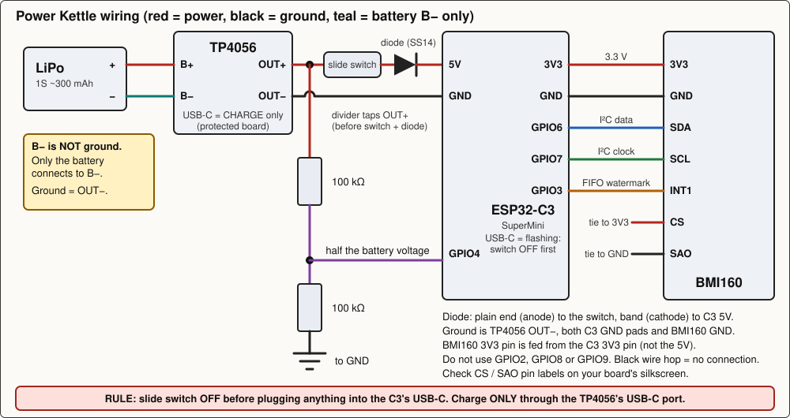

# Power Kettle: hardware build guide

This guide takes you from a bag of parts to a working sensor stuck on the
kettlebell and streaming data to your phone. You do not need to know embedded
programming. If you can solder a few wires onto small modules and use a
multimeter, you can do all of it.

Plan about one evening for the soldering and one more day for the epoxy to
cure.

Source of truth for pins and parts: spec
[section 3](../superpowers/specs/2026-10-14-power-kettle-design.md). If this
guide and the spec ever disagree, tell me; the spec wins for pins.

Contents

1. [What you are building](#1-what-you-are-building)
2. [Parts and tools](#2-parts-and-tools)
3. [Wiring](#3-wiring)
4. [Before you solder: check the BMI160 pin labels](#4-before-you-solder-check-the-bmi160-pin-labels)
5. [Build order](#5-build-order)
6. [Flash the firmware](#6-flash-the-firmware)
7. [First power-up checks](#7-first-power-up-checks)
8. [Soak test (30 minutes)](#8-soak-test-30-minutes)
9. [Mounting on the bell](#9-mounting-on-the-bell)
10. [Enabling GitHub Pages (one-time)](#10-enabling-github-pages-one-time)
11. [Troubleshooting](#11-troubleshooting)

---

## 1. What you are building

A small box that sticks to the flat front face of the bell with a magnet.
Inside:

- a **BMI160** motion sensor (accelerometer plus gyroscope) that measures how
  the bell moves 400 times per second;
- an **ESP32-C3 SuperMini**, a thumb-sized computer with Bluetooth that reads
  the sensor and sends the numbers to your phone;
- a **LiPo battery** with a **TP4056** charger board and a **slide switch**.

The box does no analysis. It just sends raw numbers; the phone saves them and
a Python program analyses them later.

Power path in one line: LiPo, TP4056 (charges the battery and cuts it off if it
gets too empty), slide switch, a small diode, the C3's **5V** pin. The C3 has a built-in
regulator that turns that into a steady 3.3 V, which also powers the sensor.
No extra voltage converter is needed.

## 2. Parts and tools

| Part | Notes | Search terms |
|---|---|---|
| ESP32-C3 SuperMini | Owned. Bluetooth 5, USB-C (used for flashing only). Has an onboard 3.3 V regulator. | "ESP32-C3 SuperMini" |
| BMI160 breakout (purple GY-BMI160) | Owned. The motion sensor. | "GY-BMI160" |
| 1S LiPo battery, about 300 mAh, e.g. size 402535 | About 5 h of streaming. Mind the plug type (see section 5, step 7). | "402535 3.7V 300mAh lipo" |
| TP4056 USB-C charger **with protection** | The protected version has **two extra small chips next to the TP4056 chip, marked DW01A and 8205A**, and 6 solder pads (B+, B−, OUT+, OUT−, plus two for the USB). The plain 4-pad one has no over-discharge protection; do not use it. Its USB-C port is for charging only. | "TP4056 type-c 6 pin protection DW01" |
| **4.7 kΩ resistor** (SMD, same size as the one you are replacing, probably 0805 or 0603) | **Mandatory.** Replaces the TP4056's charge-current resistor so the battery is charged gently (section 5, step 1). | "4.7k ohm resistor SMD 0805" (or 0603) |
| **Schottky diode**, SS14 or 1N5817 | Protects the battery from the C3's USB port (section 3). One diode is enough. | "SS14 schottky diode" or "1N5817" |
| Slide switch | Battery on/off. Small SPDT or SPST slide switch. | "SS12D00 slide switch" or "mini slide switch 3 pin" |
| 2 x 100 kΩ resistors | Battery voltage divider (quarter-watt, any 1 % or 5 %). | "100k ohm resistor 1/4W" |
| Pot magnet, 20 to 25 mm, countersunk | Holds the box on the bell. Pull strength matters: about 30 N shear against about 7 N needed. | "pot magnet 25mm countersunk neodymium" |
| Small ABS project box, about 50 x 35 x 15 mm | No 3D printer needed. | "ABS enclosure 50x35x15" |
| Two-part epoxy (5 to 30 min type) | For magnet and sensor board. | "epoxy AB 5 minute" |

Also: thin hookup wire (silicone, 26 to 30 AWG, red, black and a few other
colours), heat-shrink tubing or Kapton tape, a thin rubber pad or a steel
washer (see section 9), optionally a 2-pin JST connector pigtail that matches
your battery's plug (section 5, step 7), and a label maker or masking tape and
a marker for labelling the two USB ports.

Tools: soldering iron with a fine tip, solder, flux (helps a lot on small
pads), solder wick, wire cutters and strippers, **multimeter** (resistance,
continuity beep, DC voltage, diode test), tweezers, a USB data cable (not a
charge-only cable) for flashing, and a desktop or laptop with Chrome.

Safety with the LiPo: never short the two wires together, never puncture or
bend the cell, never solder on it while it is connected to anything powered,
and keep the protected TP4056 in the circuit. If it ever gets hot, swells or
smells, disconnect it and stop using it.

## 3. Wiring

> **RULE: Slide switch OFF before plugging anything into the C3's USB-C.
> Charge ONLY through the TP4056's USB-C port.**
>
> Why: the C3's 5V pad is wired straight to its USB port, and on the protected
> TP4056 the OUT+ pad is the battery's positive. With the switch ON and a
> cable in the C3, 5 V would be pushed into the LiPo without going through the
> charger. The diode below stops most of this; the rule covers the rest. Label
> the two USB ports on the box: **"C3: switch OFF first"** and **"CHARGE"**.



Plain-text version of the same wiring (if the picture does not display, open
[wiring.svg](wiring.svg) directly):

| From | To | Why |
|---|---|---|
| LiPo | TP4056 **B+** / **B−** | Battery connects to the charger board's battery pads. **B− is NOT ground.** Only the battery's negative wire goes to B−; the ground of the circuit is **OUT−**. B− is the unprotected battery side: anything else connected to it bypasses the protection chip. |
| TP4056 **OUT+** | slide switch → **Schottky diode** → C3 **5V** | The switch cuts power to everything. The diode (**anode, the plain end, on the switch side; cathode, the end with the band, on the C3 side**) lets current flow from the battery to the C3 but not back from the C3's USB port into the battery. It costs about 0.3 V. |
| TP4056 **OUT−** | C3 **GND** | This is the ground of the whole circuit. |
| C3 **3V3** | BMI160 **3V3** | Powers the sensor straight from the C3's regulator. Use the board's **3V3** pin, not its VIN pin (VIN goes through the breakout's own regulator, which we skip). |
| C3 **GND** | BMI160 **GND** | Common ground. |
| C3 **GPIO6** | BMI160 **SDA** | I²C data line (the two-wire bus the sensor talks over). |
| C3 **GPIO7** | BMI160 **SCL** | I²C clock line. Runs at 400 kHz. |
| C3 **GPIO3** | BMI160 **INT1** | Sensor taps this pin when 20 new samples are ready. |
| TP4056 **OUT+** (before the switch) → 100 kΩ → C3 **GPIO4** → 100 kΩ → GND | divider, see diagram | Battery voltage sensing. The C3's ADC (analogue-to-digital converter, the part that measures voltage) can only measure about 0 to 2.5 V in the mode the firmware uses, so two equal resistors halve the battery's 3.3 to 4.2 V. The firmware doubles the reading. |
| BMI160 **CS** | 3V3 (high) | Tells the sensor to use I²C rather than SPI. |
| BMI160 **SAO** (sometimes labelled SDO) | GND (low) | Selects I²C address 0x68, which is what the firmware expects. |

Pins to leave alone: **GPIO2, GPIO8, GPIO9**. These are "strapping" pins that
the C3 reads at power-up to decide how to boot, so loads on them can stop it
starting. GPIO8 is the onboard LED, which the firmware uses for status only.
GPIO9 is the BOOT button.

Notes on the battery sense and the diode:

- Tap the divider on the **OUT+ pad, before the switch and before the
  diode**. On a protected TP4056, OUT+ is electrically the same wire as B+
  (the battery positive), which is what the spec calls "BAT+". You will
  confirm this with a continuity beep in section 5, step 1. Measuring before
  the diode means the reading is the true battery voltage, not 0.3 V lower.
- The battery reads about 0 mV when no battery is attached (the divider sees
  nothing), even if the C3 is running from USB.
- The divider draws about 18 µA from the battery all the time, even with the
  switch off (with the switch off and no USB, a few more µA leak into the
  unpowered C3 through GPIO4). That is negligible, but it is why you should
  not leave the battery connected for months without charging.
- The diode's 0.3 V drop means the C3 sees about 0.3 V less than the battery.
  The C3's regulator needs a little headroom, so its 3.3 V output starts to
  sag once the battery is below about 3.7 V, but it stays at 3.0 V or more
  down to about 3.4 V. The firmware's low-battery threshold of 3500 mV
  therefore still gives a warning before the electronics stop working.

## 4. Before you solder: check the BMI160 pin labels

BMI160 breakout boards from different sellers label pins slightly differently,
and some already have CS or SAO tied to something on the board, either by a
tiny resistor or by a hard connection. Check yours first. Two small settings
matter:

- **CS** (chip select). The BMI160 decides at power-up whether to talk I²C or
  SPI based on CS. For I²C, **CS must be high** (3.3 V).
- **SAO / SDO**. This sets the I²C address: **low = 0x68** (what the firmware
  uses), high = 0x69.

Steps (board unpowered, nothing connected to it):

1. Look at the board silkscreen (the printed text). Write down the order of
   the pins. Typical labels: VIN (or VCC), 3V3, GND, SCL, SDA, CS, SAO (some
   boards print SDO instead of SAO), **INT1**, **INT2**. We use INT1 only;
   leave INT2 unconnected.
2. Set the multimeter to **resistance (Ω)**, not the continuity beep. A beep
   only tells you the resistance is below a few tens of ohms; it cannot tell
   a hard connection from a small resistor, and that difference matters here.
   First measure **3V3 to GND**: it should read high (kΩ or more, possibly
   climbing slowly). If it reads near 0 Ω, the board is faulty; stop.
3. Measure these four pairs and write the four numbers down:
   **CS to 3V3**, **CS to GND**, **SAO to 3V3**, **SAO to GND**.
   Read each as: near 0 Ω (under about 10 Ω) = hard connection; a few kΩ to a
   few hundred kΩ = a resistor to that rail; "OL" or very high = no
   connection.
4. Decide, checking **both** rails each time:
   - **CS**: if it is hard-connected to **GND** (near 0 Ω to GND), **stop**: a
     jumper from CS to 3V3 would short 3V3 to GND through it. Cut the board's
     tie, or use a different board. If CS already reads a resistor or hard
     connection to 3V3, nothing to do. If it reads a resistor to GND (a pull-
     down), the jumper to 3V3 still works but wastes a little current. If it
     reads open to both, add a short jumper from CS to 3V3 in the build.
   - **SAO**: same logic mirrored. Hard-connected to 3V3 gives address 0x69,
     which the firmware will not find ("chip not found"); cut that tie. If it
     is already tied (hard or by a resistor) to GND, nothing to do. If it is
     open to both, add a jumper from SAO to GND. Never add a jumper to a rail
     the pin is hard-tied to the other rail of.
5. Check the labels against the wiring table in section 3. The diagram uses
   the names SDA, SCL, INT1, CS, SAO. If your board prints something different
   for any of them, trust the silkscreen and look the board up.

## 5. Build order

Three principles:

- **Do all the wiring first, and attach the battery last.** The battery cell
  is always live, and the battery's negative wire sits next to the board's
  unprotected B− pad.
- **Switch OFF and battery disconnected while soldering**, every time. Each
  soldering step below repeats this.
- Test each stage before the next one hides it.

### Step 1: the TP4056 board (mandatory charge-current fix, no battery)

*Switch OFF / no battery: nothing is connected to this board yet.*

**Why this matters.** The TP4056 charges at a current set by one small
resistor ("R_PROG", on the chip's pin 2). The rule of thumb is
**charge current in mA = 1200 ÷ R in kΩ**. These modules are almost always
sold with a **1.2 kΩ** resistor, which means **1000 mA**. Your battery holds
only 300 mAh, so 1000 mA is about 3.3 times its capacity per hour (3.3 C).
Normal LiPo cells are meant to be charged at 1 C or less (300 mA here). Charging
at 3.3 C makes the cell hot, wears it out fast and can make it swell or catch
fire. So before it ever sees the battery, change the resistor to **4.7 kΩ**:
1200 ÷ 4.7 ≈ **255 mA**, under 1 C.

1. Find the **TP4056 chip**: an 8-pin chip with "TP4056" printed on it.
   Pin 1 is at the dot or the corner marked on the chip; pin 2 is the next pin
   along the same side (its name is PROG).
2. Find the small rectangular resistor connected to **pin 2**, usually
   right next to the chip. It is typically marked **122** (that code means
   12 followed by two zeros: 1200 Ω = 1.2 kΩ). Other markings for the same
   value: 1201, 1.2k. Confirm with the multimeter: measured from pin 2 to
   the board's ground (the OUT− side), it should read about 1.2 kΩ.
   A different value is possible (marked 102 = 1 kΩ, 152 = 1.5 kΩ, 222 =
   2.2 kΩ...): in that case divide 1200 by what you find to see what current
   you have, and still replace it with 4.7 kΩ (marked **472**).
3. Remove that resistor: add fresh solder to both ends, then heat both ends
   alternately and nudge the resistor off with tweezers (or use solder wick
   and a hot iron, or a hot-air tool). Clean the pads with flux and wick.
4. Solder the **4.7 kΩ** resistor (marked 472) in its place. Cool; wipe off
   flux with alcohol. Check there is no solder bridge to the neighbouring chip
   pins.
5. Measure pin 2 to ground again: about **4.7 kΩ**. If you read 1.2 kΩ, you
   fitted nothing or fitted the wrong part. Fix before going on.
6. Confirm the board is the **protected** kind: two extra small chips near
   the TP4056 marked **DW01A** and **8205A**. If you cannot find them, do not
   use the board.
7. **OUT+ and B+ must be the same wire.** With the multimeter in continuity
   mode, touch **B+** and **OUT+**: it should beep. (B− and OUT− are *not* the
   same wire on this board, and must never be joined: the protection chip sits
   between them.)

**Charge only with the slide switch OFF.** While the switch is ON, the C3 and
sensor take current from the same wire the charger feeds, so the charger can
never see the battery as full and does not stop at the right moment. Always
turn it off to charge.

**USB cable note.** Some USB-C TP4056 boards lack the two small resistors on
the USB-C connector (CC resistors) and then do not charge from a USB-C to USB-C
charger. If a C-to-C charger does nothing, use a **USB-A to USB-C** cable
instead (from a computer or an A-type charger).

### Step 2: slide switch and diode

*Switch OFF, battery not connected.*

1. Solder a short red wire to **OUT+** and a short black wire to **OUT−** on
   the TP4056 board.
2. Cut the red wire in the middle and solder the slide switch into it (use the
   middle pin and one outer pin of a 3-pin switch). Cover the joints with
   heat-shrink.
3. Solder the **Schottky diode** into the red wire after the switch: the
   **plain end (anode) toward the switch, the end with the band (cathode)
   toward the C3**. Cover the joints with heat-shrink. Current flows from
   plain end to banded end.
4. Check the diode with the multimeter on diode-test mode: red probe on the
   plain end, black on the banded end shows about 0.15 to 0.35 V; swapped
   shows "OL".
5. Continuity check: with the switch on, the OUT+ end of the wire beeps to the
   diode's plain end; with the switch off, it does not.

### Step 3: the C3 and the battery-sense divider

*Switch OFF, battery not connected.*

1. Solder the black wire from **OUT−** to a **GND** pad on the C3.
2. Solder the red wire (after the diode) to the C3 **5V** pad.
3. Build the divider: join the two 100 kΩ resistors end to end. Solder one free
   end to the **OUT+ pad** (the same pad as the red wire to the switch, so
   before the switch and before the diode). Solder the other free end to a C3
   **GND** pad (or the black OUT− wire). Solder a short wire from the
   **junction between the two resistors** to **GPIO4**. Cover each bare joint
   with heat-shrink or Kapton tape so nothing shorts.
4. **Do not** connect any other peripheral to GPIO2, GPIO8 or GPIO9.

### Step 4: the sensor

*Switch OFF, battery not connected.*

1. Decide on the CS / SAO wires from your section 4 notes.
2. Solder 3V3 (C3) to BMI160 **3V3**, GND to GND, **GPIO6 to SDA**,
   **GPIO7 to SCL**, **GPIO3 to INT1**.
3. Add the CS-to-3V3 and SAO-to-GND jumpers only if your section 4 notes say
   so.
4. Check the I²C wires have not swapped: SDA is GPIO6, SCL is GPIO7.

### Step 5: checks with no battery

*Switch OFF, battery not connected.*

1. Multimeter in continuity mode: check there are no solder bridges between
   neighbouring pads (SDA to SCL should not beep; 3V3 to GND should not
   beep). With the switch OFF, **OUT+ to OUT−** should not beep.
2. Resistance mode, switch OFF: **OUT+ to OUT−** reads roughly 200 kΩ (the two
   divider resistors in series; it may take a moment to settle). A reading
   below about 100 kΩ, or near 0, means a short; find it before going on.
3. Switch ON: the 5V pad to GND should not read as a short either.

### Step 6: flash and test without the battery

*Still no battery.* Do sections 6 and 7 (parts A) with everything wired but
loose on the desk. It is far easier to fix a wire now than inside the box.
Remember the rule: **switch OFF before plugging a cable into the C3**.

### Step 7: attach the battery, last

1. LiPo plugs and TP4056 boards from different sellers are **not always wired
   the same way round**. A wrong connection can destroy the charger and is a
   fire risk. Find the battery's red (+) and black (−) wires. With a
   multimeter on DC volts, red probe on the red wire: you should read about
   3.3 to 4.2 V with a **positive** sign. A negative sign means the wire
   colours are swapped (go by the meter, not the colour).
2. **Preferred, no soldering on a live cell:** buy a 2-pin connector pigtail
   that mates with your battery's plug (usually JST-PH 2.0 or JST-SH 1.25;
   check the plug). With the **switch OFF and the battery unplugged**, solder
   the pigtail's wires to **B+** and **B−** on the TP4056. Check the pigtail's
   polarity with the meter against the battery plug: the battery's red pin
   must meet the pigtail wire going to **B+**. Only then plug the battery in.
3. **If the battery has bare wires** (or its plug does not match and you cut
   it off): with the **switch OFF**, cover the bare end of the **black** wire
   with Kapton tape, then solder the **red** wire to **B+**. Only then
   uncover the black wire and solder it to **B−**. Keep the iron tip away
   from the neighbouring pad: B+ and B− are close together, and a short
   across the cell is dangerous. At no point may the two bare ends touch each
   other or the board's other pads.
4. **Battery is on now.** With the switch OFF, measure between **OUT+** and
   **OUT−**: you should read the battery voltage (3.3 to 4.2 V). If the
   battery reads 3.3 V or less, charge it first (next step) before any other
   test.
5. **Charge test (switch OFF).** Plug a charger into the **TP4056's** USB-C
   port. One LED should show charging (usually red), turning off or changing
   to a different colour (usually green or blue) when full. At about 255 mA a
   flat 300 mAh cell takes roughly 1.5 to 2 hours. Check by touch after a few
   minutes that the cell and the TP4056 chip are only warm, not hot. If hot,
   unplug and recheck the 4.7 kΩ resistor.
6. Switch ON, with the C3 **not** on USB, and measure the **junction of the
   two divider resistors** to ground: half the battery voltage (for example
   about 1.9 V for a 3.8 V battery). Measure with the switch ON so the C3 is
   powered; with the switch OFF, a little current leaks into the unpowered C3
   and the reading can be a bit low.

Continue with section 7, parts B and C.

## 6. Flash the firmware

"Flashing" means copying the program onto the C3. You only do it once, or
again when the firmware is updated.

> **RULE: Slide switch OFF before plugging anything into the C3's USB-C.
> Charge ONLY through the TP4056's USB-C port.**

With the switch off, the C3 is powered only from the USB cable, which is what
you want while flashing. It makes no difference whether the battery is
attached or not.

1. Use **desktop Chrome or Edge** (Safari, Firefox and Android Chrome do not
   work for this). The page needs the firmware to be published first; see
   [section 10](#10-enabling-github-pages-one-time).
2. **Check the slide switch is OFF.** Then plug the C3 into the computer with
   a USB **data** cable.
3. Open <https://matias-ceau.github.io/power-kettle/flash.html>.
4. Click **Install**, pick the C3 in the list that pops up (it often appears
   as "USB JTAG/serial debug unit" or "ESP32-C3"), and confirm. It takes about
   30 s. Wait for "Installation complete".
5. If the C3 does not show up in the list: unplug it, **hold the BOOT button**
   (tiny button on the board), plug it back in while holding it, release, then
   try again.
6. When done, unplug the cable **before** switching the device on.

**Reflashing later, with the device in its box:** same rule. Switch OFF,
plug into the **C3's** port (the one labelled "C3: switch OFF first"), flash,
unplug, then switch on. Never use the TP4056 port for flashing, and never the
C3 port for charging.

For developers (needs PlatformIO and the repo checked out; the same rule
applies, switch OFF first):

```bash
cd firmware && pio run -e c3 -t upload
```

## 7. First power-up checks

Remember the rule: **slide switch OFF before plugging anything into the C3's
USB-C. Charge only through the TP4056's USB-C port.**

What you should see depends on whether the battery is attached. The LED has
three modes: slow blink 1 Hz = advertising (waiting for a phone), solid on =
connected, fast blink 5 Hz = **low battery (below 3500 mV)**. Low battery
**overrides** the other two: if the battery reads below 3500 mV, the LED
fast-blinks even while connected.

**Part A: no battery attached (C3 on USB only, switch OFF).**

1. **LED**: fast blink, even once a phone is connected. The battery reading
   is about 0 mV (nothing for the divider to measure), so the firmware thinks
   the battery is low. This is expected. The record page shows "Low battery"
   and about 0 mV.
2. **Record page connects.** On an Android phone with Bluetooth and location
   switched on, open Chrome and go to
   <https://matias-ceau.github.io/power-kettle/record.html>. Tap **Connect**,
   pick **PowerKettle**. (On the bench the page, not the LED, tells you it is
   connected.)
3. **Start recording** and watch the readouts for 10 to 20 seconds with the
   sensor lying still:
   - **Samples** keeps climbing.
   - **Rate (Hz)** settles at about **400** (anything within about 396 to 404
     is fine; the chip clock is up to about 1 % off by design and the analysis
     corrects for it).
   - **Gaps** stays at 0 and **Dropped** stays at 0.
4. Tap **Stop & save** and check the file with
   `python -m powerkettle info FILE.pkraw` (see
   [recording-protocol.md](recording-protocol.md) for how to get it onto a
   computer). You want 1 run, about 400 Hz, 0 gaps.

**Part B: battery attached, C3 on USB (switch OFF).** After section 5, step 7.

5. **Battery mV is plausible**: with a charged LiPo, 3700 to 4200 mV, and
   within about 50 to 100 mV of your multimeter reading at OUT+. The low
   battery banner disappears.
6. **LED**: slow blink while advertising, solid once connected (provided the
   battery is 3500 mV or more).

**Part C: battery only (USB unplugged).**

7. **Slide switch.** With no cable in the C3, switch ON: within a couple of
   seconds the LED blinks slowly (or fast, if the battery is below 3500 mV:
   charge it). Connect with the record page: LED solid, battery reading
   about as in part B. Switch OFF: the LED goes out.
8. **Charging.** Switch OFF, plug a charger into the **TP4056's** USB-C port:
   the charging LED lights up.

If the sensor is not found, the serial log shows the problem. Open the serial
monitor (`pio device monitor -b 115200` or any serial terminal at **115200
baud** on the C3's USB port). **Same rule: switch OFF before you plug in the
C3's cable.** If the BMI160 is not detected it prints the chip ID failure and
retries every second. See troubleshooting.

## 8. Soak test (30 minutes)

A soak test checks that nothing falls over during a long recording. It
catches loose wires, a bad Bluetooth setup or a flaky battery.

1. Fully charge the LiPo (through the TP4056's port, **switch OFF**). Put the sensor on the desk, **not moving**.
2. Put the phone next to it (within 1 m) with the screen on and Chrome in the
   foreground. Turn off battery saver. The record page keeps the screen awake
   by itself.
3. On the record page, note the **Battery** reading (mV). Tap **Start
   recording**.
4. Leave for **30 minutes** without touching the sensor or the phone.
5. Note the **Battery** reading again, then tap **Stop & save**.
6. Get the file onto a computer (see
   [recording-protocol.md](recording-protocol.md), "Getting files to your
   computer") and run:

   ```bash
   pip install git+https://github.com/matias-ceau/power-kettle
   python -m powerkettle info pk-YYYYMMDD-HHMMSS.pkraw
   ```

**Pass criteria**

| Line in the output | Expected |
|---|---|
| `runs:` | **1** |
| `rate` on the run line | **400 ± 4 Hz** (396 to 404) |
| `gaps:` | **0** (and 0 samples dropped) |
| `duration:` | about 1800 s (30 min) |
| `samples:` | about 720,000 |

Also write down the **battery drop** (mV at start minus mV at end). A healthy
cell should lose only a small amount in 30 minutes (my expectation is a few
tens of mV, but this is a first measurement, so your number becomes the
baseline). A drop of 200 mV or more suggests an old cell or extra current
draw. Keep the numbers; they tell you the real runtime.

If it does not pass: more than 1 run means the phone and sensor disconnected;
gaps mean data was lost (phone too far away, Chrome in the background, battery
saver). Try again closer; if it keeps happening, tell me and bring the file.

## 9. Mounting on the bell

Do this only after the bench tests and the soak test pass.

### Where it goes

On the **front flat face** of the bell, the circular "32KG" plate (about 10 cm
across), on the side that faces you at the hike (the backswing start). Why
there: it is the one place that is away from the handle window and from the
forearm contact for either hand.

### Dummy-box clearance test (do not skip)

Gluing a magnet to the wrong spot is annoying. Test first:

1. Make a dummy: a cardboard box about 50 x 35 x 15 mm, or just use the real
   box lid with nothing in it.
2. Tape it centred on the front face with painter's tape (removes cleanly).
3. Do a few easy swings and snatches with each hand, slowly at first, and
   watch for:
   - the forearm brushing the box;
   - the bell hitting your thighs or hips on the way back;
   - the box touching anything at the top of the snatch.
4. Adjust the position until nothing touches. Mark the final spot with a
   pencil dot.

### Build the box

1. **Rigid sensor board.** Fix the BMI160 board **rigidly** to the box,
   **parallel to the box base** (the side that touches the bell), components
   facing up. Use epoxy or a small screw with spacers. **No foam, no tape
   cushion**: any flex between sensor and bell shows up as noise. The reason
   it must be parallel is that one of the sensor's axes then points straight
   out of the bell's face, which the analysis relies on. It does not matter
   how the box is rotated on the face; the app handles that at the start of
   every session.
2. Put the C3, charger board and battery in the box; keep wires short and
   tidy, and make sure the **slide switch** and the charger's USB-C port are
   reachable through cutouts (small holes you make with a hobby knife or
   rotary tool). Cover bare solder joints and the underside of the boards
   with Kapton tape so nothing shorts against anything else inside the box.
3. Make sure the C3's USB-C is reachable if you want to reflash later, or
   plan to open the box. **Label the two USB ports on the outside of the
   box**: "**C3: switch OFF first**" on the C3's port and "**CHARGE**" on the
   TP4056's port. **Rule: slide switch OFF before plugging anything into the
   C3's USB-C; charge ONLY through the TP4056's USB-C port.**

### Magnet

1. Roughen the magnet's back and the box base with sandpaper and wipe with
   alcohol.
2. **Epoxy the pot magnet to the box base**, flat side outward (the countersunk
   hole filled by epoxy or left empty, whichever you prefer). Let it cure
   fully (24 h for most epoxies even if the label says 5 minutes).
3. If the raised lettering of the "32KG" plate stops the magnet sitting flat,
   put a **thin rubber pad or a steel washer** between magnet and bell so it
   grips without rocking.
4. Before the first session, pull on the box with your hand sideways and
   upwards: it should not slide. If it slips, add a strip of VHB double-sided
   tape between magnet and bell as a backup.

Check the box after the first few sessions, and tape the cable cutouts if you
see any wobble.

## 10. Enabling GitHub Pages (one-time)

The flasher page and the record page are served from GitHub Pages. This is a
one-time setup in the repository settings:

1. On GitHub, open the repository, **Settings**, **Pages**.
2. Under **Build and deployment**, set **Source** to **GitHub Actions**.
3. The site is built and published from the **`main` branch**. If this
   milestone's work is still on another branch, merge it into `main` first;
   the publishing workflow ("Deploy Pages") runs automatically on every push to
   `main`. You can watch it under the **Actions** tab. A green tick means the
   site is live.
4. After the first successful run the pages are at
   - <https://matias-ceau.github.io/power-kettle/flash.html>
   - <https://matias-ceau.github.io/power-kettle/record.html>

   It can take a minute or so after the workflow finishes before they load.

## 11. Troubleshooting

> **RULE: Slide switch OFF before plugging anything into the C3's USB-C.
> Charge ONLY through the TP4056's USB-C port.**

| Symptom | Likely cause and fix |
|---|---|
| Nothing happens when switched on, no LED | Battery not connected or flat. Check the voltage between TP4056 OUT+ and OUT−. Check the switch and the diode are wired in the red wire, and that the diode band faces the C3. |
| C3 not listed in the flash dialog | Charge-only USB cable. Use another. Or hold BOOT while plugging in. Also check the slide switch is OFF. |
| LED blinks fast | Low battery: the reading is below 3500 mV, or no battery is attached (reads about 0 mV). Low battery overrides "solid when connected", so it blinks fast even while connected. Charge the battery (switch OFF, TP4056 port). |
| LED blinks slowly, phone cannot find "PowerKettle" | Bluetooth and location off on the phone; another phone is already connected; or you are not using Chrome. |
| Record page says no Web Bluetooth | Use Chrome on Android (not Firefox, not an in-app browser). |
| Rate far from 400 Hz, or no samples | Sensor not talking. See next row. |
| Serial log says chip ID failure (retries every second) | BMI160 not found. Check SDA/SCL are not swapped, 3V3 and GND are connected, **SAO is low** (address 0x68), **CS is high**, and no solder bridges. Reminder: switch OFF before plugging in the C3's USB for the serial monitor. |
| Battery mV reads 0 with a battery attached | Divider not connected to OUT+ or GPIO4, or a broken resistor joint. |
| Battery mV reads about double or half | Check both resistors are really 100 kΩ and the midpoint goes to GPIO4. |
| Charging LED never goes out, or the cell or TP4056 chip gets hot | Unplug. Check the 4.7 kΩ charge-current resistor was really fitted (pin 2 to ground reads about 4.7 kΩ), and that the switch was OFF while charging. |
| Charger does nothing with a USB-C to USB-C cable | The board may lack the CC resistors on its USB-C port. Use a USB-A to USB-C cable. |
| Gaps in a recording | Phone too far, Chrome in the background, battery saver on. |
| Device resets or disconnects when moved | Loose wire or solder joint. Strain-relieve the wires. |
